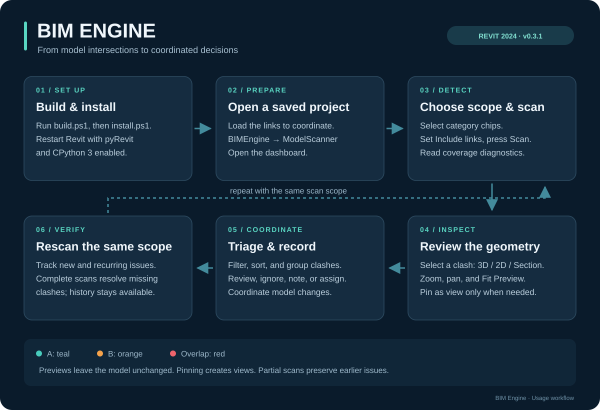
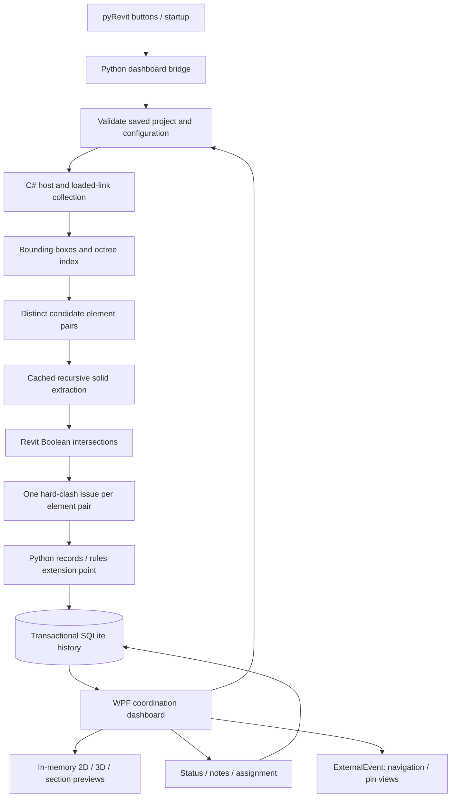

# BIM Engine

**Clash detection and coordination inside Autodesk Revit.**

BIM Engine is a pyRevit extension that finds solid intersections across a host
model and loaded Revit links, then turns results into a persistent review
workflow. Scan selected categories, inspect clashes, record decisions, and
rescan to track what changed.

**v0.3.1 · Revit 2024 · CPython 3 · C# / .NET Framework 4.8 · WPF · SQLite**

[Getting started](#getting-started) · [Usage map](#usage-map) ·
[How it works](#how-it-works) · [Configuration](#configuration) ·
[Detailed user guide](docs/user-guide.md) · [Validation](#validation)

## Capabilities

| Feature | What it provides |
| --- | --- |
| Model scanning | Hard-clash detection across selected host and loaded linked-model categories |
| Spatial filtering | An octree and bounding boxes reduce pairs before solid intersection tests |
| Geometry inspection | Embedded 3D, 2D, and section previews with pan, zoom, fit, and nearby context |
| Coordination dashboard | Search, sorting, grouping by level/pair/status, and combined filters |
| Issue triage | Reviewed/ignored states, notes, assignments, and selected-pair bulk ignore |
| Scan history | Project-scoped SQLite records, new/recurring tracking, reopening, and scope-aware resolution |
| Native Revit views | Explicit view pinning and protected cleanup of generated views |
| Flexible workspace | Docked/floating layouts with Revit light/dark theme integration |

## Usage map



[Open the standalone visual map](docs/usage-map.svg).

## Getting started

### Requirements

| Component | Requirement |
| --- | --- |
| Platform | Windows with **Autodesk Revit 2024** installed |
| pyRevit | Installed and attached to Revit 2024, with CPython 3 support |
| Build tools | .NET SDK with .NET Framework 4.8 targeting/build support |
| Offline validation | Python 3; .NET 8 SDK for the spatial harness |

This release supports Revit 2024 only. Revit 2025+ requires a separate compatible
build. pyRevit loads the compiled `.NET Framework 4.8` library into Revit.

### 1. Clone and build

Run in PowerShell:

```powershell
git clone https://github.com/Ah2022/BIM-Engine.git
cd BIM-Engine
.\build.ps1
```

The default API directory is `C:\Program Files\Autodesk\Revit 2024`.
For another installation location:

```powershell
.\build.ps1 -RevitApiPath 'D:\Autodesk\Revit 2024'
```

Build stages `BIMEngine.Core.dll` in `BIMEngine.extension/bin/` and generates a
SHA-256 package manifest. Build output and the generated manifest are excluded
from source control. Autodesk API assemblies come from your Revit installation.

### 2. Install and restart Revit

Close Revit before updating an installed engine, then run:

```powershell
.\install.ps1
```

The installer validates the package and installs it to
`%APPDATA%\pyRevit\Extensions\BIMEngine.extension`. An existing installation is
moved to a timestamped backup under `%APPDATA%\pyRevit\BIMEngine-backups`.
Installation and backup paths are recorded in `verification/installation.json`.

Start Revit 2024 and open **BIMEngine → ModelScanner**. The **Scan**,
**Settings**, and **Issue Report** buttons all open the coordination dashboard.
Restart Revit whenever a loaded engine DLL is replaced.

### 3. Run your first scan

1. Open and **save** a Revit project. Load the links you want to include.
2. Open the dashboard and choose category chips in its Scan panel.
3. Set **Include links**, then press **Scan**. Read the summary and coverage
   warnings under **Details**.
4. Select a clash for an automatic **3D** preview; switch to **2D** or **Section**.
5. Use **Reviewed**, **Ignore**, **Add note**, or **Assign** to record your decision.
6. Coordinate changes in the model, then scan with the **same scope** to track
   new, recurring, reopened, and resolved issues.

## Reviewing results

**Inspect.** A is teal, B is orange, and overlap is red. Wheel to zoom, drag to
pan, and use **Fit Preview** to reset. The gear controls rotation, section axis,
focus, and nearby context. Previews run in memory; **Pin as view** explicitly
creates a native Revit view.

**Prioritize.** Combine search, status, type, age, and discipline filters. Sort
columns or group by Level, Pair, or Status. **Most likely real** prioritizes named
systems and larger overlaps; this is a review order, not another geometry test.
List filters affect presentation; category/link choices determine scan scope.

**Record decisions.** Notes append to existing text. Assignment appends
`Assigned to: Name` and displays the latest assignee without sending notifications.
For bulk ignore, filter to one pair type, select rows using Ctrl/Shift, and choose
**Mark selected ignored**. Notes and review states survive repeat scans.

**Navigate.** Previous/Next follows the visible sorted list. Up/Down moves through
focused rows, Enter opens 3D, Space selects elements in Revit, and Ctrl+F focuses
search. **Undock** opens a floating dashboard.

The [detailed user guide](docs/user-guide.md) covers layouts, keyboard behavior,
generated-view cleanup protections, database upgrades, and preview limits.

## How it works



1. **Collect and identify.** Gather supported elements and system metadata;
   transform linked geometry into host coordinates. Persisted identity includes
   project/document identity, element UniqueId, and link instance UniqueId,
   distinguishing repeated link instances even when numeric element IDs match.
2. **Find candidates.** Index bounding boxes in an octree, then form distinct
   nearby element pairs to reduce expensive geometry comparisons.
3. **Check solids.** Recursively extract usable solids, including nested family
   geometry. Cache each candidate element's geometry once per scan. Test for
   positive-volume Boolean intersections and emit one issue per element pair.
4. **Persist history.** Convert .NET results to Python records; transactionally
   store scan snapshots, diagnostics, metrics, and issues in SQLite. Complete
   scans resolve absent issues only for the exact same scope. Partial scans retain
   earlier issues. Resolved issues reopen when detected again.
5. **Coordinate.** A modeless WPF dashboard reads project-scoped snapshots.
   Revit actions use `ExternalEvent`; model changes invalidate previews and
   project changes refresh dashboard context.

Scanning runs on Revit's API thread. Geometry collection and Boolean operations
are not background Revit API work. Scan and preview operations do not edit the
model; explicit pinning and generated-view cleanup do.

## Configuration

User settings: `%APPDATA%\pyRevit\BIMEngine\scan_config.json`

```json
{
  "Categories": ["Pipes", "Ducts", "Cable Trays", "Structural Framing", "Structural Columns"],
  "IncludeLinkedDocuments": true,
  "OctreeMaxObjectsPerNode": 16,
  "OctreeMaxDepth": 8,
  "CandidateQueryPaddingFeet": 0.01
}
```

| Setting | Accepted values |
| --- | --- |
| `Categories` | Nonempty list: Pipes, Ducts, Cable Trays, Structural Framing, Structural Columns, Duct Terminals, Air Terminals, Pipe Accessories |
| `IncludeLinkedDocuments` | `true` / `false` |
| `OctreeMaxObjectsPerNode` | Integer 1–4096 |
| `OctreeMaxDepth` | Integer 1–16 |
| `CandidateQueryPaddingFeet` | Number 0–1 feet; candidate-search padding, not clearance checking |

The dashboard starts with the project's last scan scope, or user defaults for a
project without scans. Advanced options remain in JSON.

Issue database: `%APPDATA%\pyRevit\BIMEngine\bimengine_issues.db`.
`BIMENGINE_DB_PATH` selects an alternative database for isolated tests.
Schema upgrades create backups; see [database upgrades](docs/user-guide.md#database-upgrade).
Project identity includes its path: **Save As** to another path starts separate history.

## Scope and limitations

- **Hard clashes only.** BCF export, clearance checks, AI resolution suggestions,
  compliance calculations, and advanced rule filtering remain future extension
  points. Placeholder modules do not implement these capabilities.
- **Overlap size is a score.** It is the cube root of the largest solid-pair
  intersection volume, displayed in millimetres, rather than penetration depth.
- **Coverage matters.** Missing geometry, Boolean failures, unloaded links,
  mirrored links, and nested Revit links produce diagnostics. Mirrored/nested
  Revit links are not fully supported; nested families are supported.
- **Results are scope-specific.** An empty list does not certify the whole model.
  Scanning another category/link scope does not resolve earlier-scope issues.
- **Preview context is bounded.** Nearby context is capped at 60 elements and
  approximately 150,000 triangles. Pinned linked-model views isolate link instances
  with exact clash overlays; native isolation cannot isolate individual linked elements.

## Repository structure

```text
BIMEngine.Core/             C# Revit engine and WPF dashboard
  Collection/              Host/link collection and system metadata
  Spatial/                 AABB, octree, candidate-pair utilities
  Geometry/                Solid cache and Boolean intersections
  Dashboard/               Layout, triage, previews, navigation, pinned views
  Models/                  Scan configuration and result models
BIMEngine.extension/       pyRevit startup, ribbon buttons, Python bridge
  lib/bimengine_core/      Configuration, SQLite, dashboard adapter
tests/                     Offline tests, .NET harnesses, Revit fixtures
docs/                      Usage map and detailed operating guide
verification/              Local test/install output (ignored)
build.ps1                  Compile and stage the extension package
install.ps1                Validate, back up, and install the package
```

## Validation

Offline Python checks and the Autodesk-independent spatial harness:

```powershell
python -m unittest discover -s tests -v
dotnet run --project tests/SpatialHarness/SpatialHarness.csproj -c Release
```

If `python` is unavailable on Windows, use `py -3`.
Integration tests require a built DLL and a local Revit 2024 installation. Some
fixtures contain workspace-specific `ROOT` constants; adjust these for your
checkout. Use absolute script paths with pyRevit:

```powershell
pyrevit run "$PWD/tests/revit_integration.py" --revit=2024
dotnet build tests/DashboardHarness/DashboardHarness.csproj -c Release
.\tests\run-dashboard-verification.ps1 -ScriptPath "$PWD/tests/revit_inspection.py"
```

Tests create disposable fixture models/databases under `verification/`. The
dashboard runner leaves its isolated Revit session open for modeless events;
check result JSON for `status: passed` or `failed`.
See [test details](docs/user-guide.md#tests) and recorded reports:
[baseline](VERIFICATION.md), [Phase 2](PHASE2_VERIFICATION.md),
[Phase 2.1](PHASE2_1_VERIFICATION.md), [Phase A](PHASE_A_VERIFICATION.md),
[Phase B](PHASE_B_VERIFICATION.md), [Phase C](PHASE_C_VERIFICATION.md).
These reports describe earlier local runs; generated models, screenshots, and
raw verification output are excluded from the repository.

## Troubleshooting

| Symptom | Action |
| --- | --- |
| Revit API not found | Pass its directory to `build.ps1 -RevitApiPath` |
| Missing DLL or manifest | Run `build.ps1` before `install.ps1` |
| Package hash mismatch | Rebuild after editing extension files, then reinstall |
| BIMEngine tab missing | Check pyRevit attachment to Revit 2024 and restart Revit |
| Unsaved project rejected | Save before scanning |
| Old DLL behavior remains | Fully restart Revit after updating the engine |
| Incomplete coverage | Read Details diagnostics and investigate link/geometry conditions |

To roll back, close Revit, move the current extension outside the Extensions
folder, and restore the recorded backup as `BIMEngine.extension`.

## Contributing

Open an issue with Revit/pyRevit versions, scan scope, reproduction steps, and
relevant diagnostics. Keep client models, credentials, and local databases out
of submissions. Run applicable offline checks for code changes and include Revit
verification for geometry or dashboard changes.

**License:** No open-source license has been declared in this repository.
